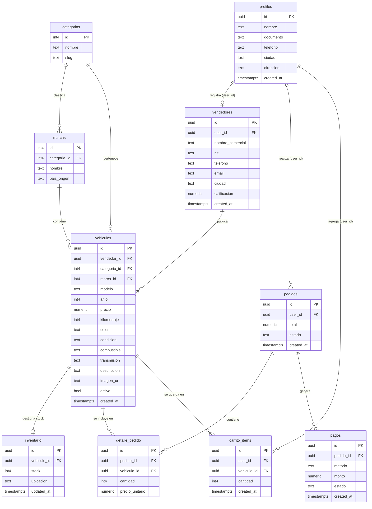

# 🚗 Mi Cacharrito — Plataforma de Compra, Venta y Gestión de Inventario Vehicular

Sistema web para el comercio y administración de inventario de vehículos (carros, motos y bicicletas), con gestión multi-tienda, autenticación segura y publicación en tiempo real.

Este proyecto surge como una solución integral para pequeñas y medianas empresas (PyMEs) del sector automotriz, permitiendo la interacción fluida entre compradores y vendedores.

---

## 🚀 Instrucciones de Ejecución Local

### Requisitos previos

- **Node.js**: versión 18.0 o superior
- **Git**
- Cuenta activa en **[Supabase](https://supabase.com)**

### 1. Clonar el repositorio e instalar dependencias

```bash
git clone https://github.com/tu-usuario/mi-cacharrito.git
cd mi-cacharrito
npm install
```

### 2. Configurar variables de entorno

Crea un archivo `.env` en la raíz del proyecto basándote en la siguiente plantilla:

```env
VITE_SUPABASE_URL=https://tu-proyecto.supabase.co
VITE_SUPABASE_ANON_KEY=tu_anon_public_key_aqui
VITE_SUPABASE_PUBLISHABLE_KEY=tu_anon_public_key_aqui
```

> Encuentra estos valores en Supabase → **Project Settings → API**.

### 3. Configurar la base de datos en Supabase

1. Ve a tu panel en Supabase.
2. Ingresa al **SQL Editor** de tu proyecto.
3. Ejecuta **en orden** el contenido de los scripts SQL:
   1. [`schema.sql`](./schema.sql) — creación de tablas, restricciones y función RPC.
   2. [`seed.sql`](./seed.sql) — datos iniciales de prueba.

### 4. Iniciar la aplicación en modo desarrollo

```bash
npm run dev
```

Abre tu navegador en [http://localhost:5173](http://localhost:5173).

---

## 📊 Diagrama Entidad-Relación (DER)

Diagrama del modelo implementado en Supabase (PostgreSQL):


### Versión en Mermaid (editable)



---

## 📜 Scripts SQL

### `schema.sql` — Creación de tablas, restricciones y funciones

```sql
-- 1. Habilitar extensión UUID
CREATE EXTENSION IF NOT EXISTS "uuid-ossp";

-- 2. Esquema de Tablas
CREATE TABLE IF NOT EXISTS public.profiles (
    id UUID PRIMARY KEY REFERENCES auth.users(id) ON DELETE CASCADE,
    nombre TEXT,
    documento TEXT,
    telefono TEXT,
    ciudad TEXT,
    direccion TEXT,
    created_at TIMESTAMPTZ DEFAULT NOW()
);

CREATE TABLE IF NOT EXISTS public.vendedores (
    id UUID PRIMARY KEY DEFAULT uuid_generate_v4(),
    user_id UUID UNIQUE REFERENCES public.profiles(id) ON DELETE CASCADE,
    nombre_comercial TEXT NOT NULL,
    nit TEXT UNIQUE,
    telefono TEXT NOT NULL,
    email TEXT,
    ciudad TEXT NOT NULL,
    calificacion NUMERIC(3,2) DEFAULT 5.00,
    created_at TIMESTAMPTZ DEFAULT NOW()
);

CREATE TABLE IF NOT EXISTS public.categorias (
    id SERIAL PRIMARY KEY,
    nombre TEXT NOT NULL UNIQUE,
    slug TEXT NOT NULL UNIQUE
);

CREATE TABLE IF NOT EXISTS public.marcas (
    id SERIAL PRIMARY KEY,
    categoria_id INT REFERENCES public.categorias(id) ON DELETE CASCADE,
    nombre TEXT NOT NULL,
    pais_origen TEXT
);

CREATE TABLE IF NOT EXISTS public.vehiculos (
    id UUID PRIMARY KEY DEFAULT uuid_generate_v4(),
    vendedor_id UUID REFERENCES public.vendedores(id) ON DELETE CASCADE,
    categoria_id INT REFERENCES public.categorias(id),
    marca_id INT REFERENCES public.marcas(id),
    modelo TEXT NOT NULL,
    anio INT NOT NULL,
    precio NUMERIC(12,2) NOT NULL,
    kilometraje INT DEFAULT 0,
    color TEXT,
    condicion TEXT DEFAULT 'usado',
    combustible TEXT,
    transmision TEXT,
    descripcion TEXT,
    imagen_url TEXT,
    activo BOOLEAN DEFAULT TRUE,
    created_at TIMESTAMPTZ DEFAULT NOW()
);

CREATE TABLE IF NOT EXISTS public.inventario (
    id UUID PRIMARY KEY DEFAULT uuid_generate_v4(),
    vehiculo_id UUID UNIQUE REFERENCES public.vehiculos(id) ON DELETE CASCADE,
    stock INT DEFAULT 1,
    ubicacion TEXT,
    updated_at TIMESTAMPTZ DEFAULT NOW()
);

CREATE TABLE IF NOT EXISTS public.pedidos (
    id UUID PRIMARY KEY DEFAULT uuid_generate_v4(),
    user_id UUID REFERENCES public.profiles(id) ON DELETE SET NULL,
    total NUMERIC(12,2) DEFAULT 0.00,
    estado TEXT DEFAULT 'pendiente',
    created_at TIMESTAMPTZ DEFAULT NOW()
);

CREATE TABLE IF NOT EXISTS public.detalle_pedido (
    id UUID PRIMARY KEY DEFAULT uuid_generate_v4(),
    pedido_id UUID REFERENCES public.pedidos(id) ON DELETE CASCADE,
    vehiculo_id UUID REFERENCES public.vehiculos(id) ON DELETE SET NULL,
    cantidad INT DEFAULT 1,
    precio_unitario NUMERIC(12,2) NOT NULL
);

CREATE TABLE IF NOT EXISTS public.pagos (
    id UUID PRIMARY KEY DEFAULT uuid_generate_v4(),
    pedido_id UUID REFERENCES public.pedidos(id) ON DELETE CASCADE,
    metodo TEXT NOT NULL,
    monto NUMERIC(12,2) NOT NULL,
    estado TEXT DEFAULT 'completado',
    created_at TIMESTAMPTZ DEFAULT NOW()
);

CREATE TABLE IF NOT EXISTS public.carrito_items (
    id UUID PRIMARY KEY DEFAULT uuid_generate_v4(),
    user_id UUID REFERENCES public.profiles(id) ON DELETE CASCADE,
    vehiculo_id UUID REFERENCES public.vehiculos(id) ON DELETE CASCADE,
    cantidad INT DEFAULT 1,
    created_at TIMESTAMPTZ DEFAULT NOW()
);

-- 3. Permisos de Accesibilidad
GRANT USAGE ON SCHEMA public TO anon, authenticated;
GRANT SELECT, INSERT, UPDATE, DELETE ON ALL TABLES IN SCHEMA public TO anon, authenticated;
GRANT USAGE, SELECT ON ALL SEQUENCES IN SCHEMA public TO anon, authenticated;

-- 4. Procedimiento Almacenado RPC: realizar_pedido
CREATE OR REPLACE FUNCTION public.realizar_pedido(
  p_metodo TEXT DEFAULT 'efectivo',
  p_vendedor_id UUID DEFAULT NULL,
  p_items JSONB DEFAULT '[]'::jsonb,
  p_direccion TEXT DEFAULT NULL
)
RETURNS JSONB
LANGUAGE plpgsql
SECURITY DEFINER
AS $$
DECLARE
  v_pedido_id UUID;
BEGIN
  INSERT INTO public.pedidos (user_id, estado, created_at)
  VALUES (auth.uid(), 'pendiente', NOW())
  RETURNING id INTO v_pedido_id;

  RETURN jsonb_build_object(
    'success', true,
    'message', 'Pedido realizado con éxito',
    'pedido_id', v_pedido_id
  );
EXCEPTION WHEN OTHERS THEN
  RETURN jsonb_build_object(
    'success', false,
    'message', SQLERRM
  );
END;
$$;

GRANT EXECUTE ON FUNCTION public.realizar_pedido TO anon, authenticated, service_role;
NOTIFY pgrst, 'reload schema';
```

### `seed.sql` — Datos iniciales de prueba

```sql
-- 1. Insertar Categorías
INSERT INTO public.categorias (id, nombre, slug) VALUES
(1, 'Carro', 'carro'),
(2, 'Moto', 'moto'),
(3, 'Bicicleta', 'bicicleta')
ON CONFLICT (id) DO NOTHING;

-- 2. Insertar Marcas
INSERT INTO public.marcas (id, categoria_id, nombre, pais_origen) VALUES
(1, 1, 'Chevrolet', 'EE.UU.'),
(2, 1, 'Renault', 'Francia'),
(3, 1, 'Toyota', 'Japón'),
(4, 1, 'Mazda', 'Japón'),
(5, 2, 'Yamaha', 'Japón'),
(6, 2, 'AKT', 'Colombia'),
(7, 2, 'Bajaj', 'India'),
(8, 3, 'GW', 'Colombia'),
(9, 3, 'Specialized', 'EE.UU.')
ON CONFLICT (id) DO NOTHING;

-- 3. Ajustar secuencias de IDs autoincrementables
SELECT setval('public.categorias_id_seq', (SELECT MAX(id) FROM public.categorias));
SELECT setval('public.marcas_id_seq', (SELECT MAX(id) FROM public.marcas));
```
